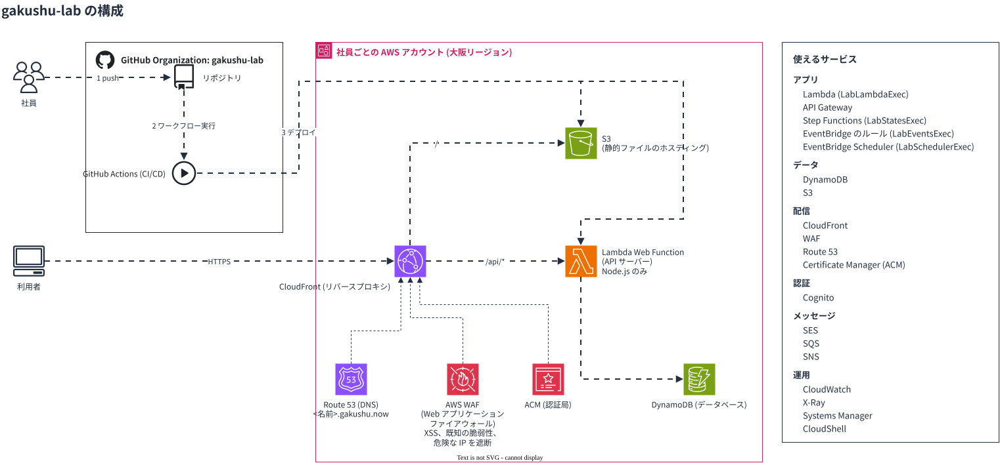

# gakushu-lab

図の元ファイルは [architecture.drawio](https://github.com/gakushu-lab/.github/blob/main/profile/guide/architecture.drawio)。

詳細な gakushu-lab の構成は[こちら](https://github.com/gakushu-lab/.github/tree/main/profile/architecture)。

## アプリのデプロイ手順

1. ドメイン (example.com のような URL のホスト名部分) を取得してDNSに登録する (Route 53)
2. データベースを作る (DynamoDB)
3. API サーバーをデプロイしてデータベースに接続させる (Lambda Web Function)
4. フロントエンドの静的ファイルをホスティングする (S3)
5. リバースプロキシで `/api/*` だけを API サーバーに転送する (CloudFront)
6. DNS の A レコードにリバースプロキシの IP アドレスを登録する (Route 53)
7. 認証局に TLS 証明書を発行してもらいリバースプロキシに設定する (ACM, CloudFront)

### AWS 上でのやり方

[こちら](https://github.com/gakushu-lab/.github/blob/main/profile/guide/deploy.md)を参照

## DevOps

上記でデプロイ手順について記述したが、開発、デプロイ、本番での課題発見を繋げることで、効率よく安全に機能を増やしたり変更しようという考え方を [DevOps](https://aws.amazon.com/devops/what-is-devops/) という。

主なものは次の4つ

1. 継続的インテグレーション (Continuous Integration, CI): push のたびにビルドとテストを自動で実行する (GitHub Actions)
2. 継続的デリバリー (Continuous Delivery, CD): テストを通った変更を、いつでも本番に出せる状態まで自動で進める (GitHub Actions)
3. Infrastructure as Code (IaC): インフラをコードで定義し、レビューして自動で適用する (Terraform)
4. 監視とログ: メトリクスとログを集め、問題を早く見つける (CloudWatch)

### gakushu-lab でのやり方

[こちら](https://github.com/gakushu-lab/.github/blob/main/profile/guide/devops.md)を参照

## 制約

使えるサービスは限られている。上の構成図の「使えるサービス」を参照

例: [hapax](https://github.com/gakushu-lab/hapax)
