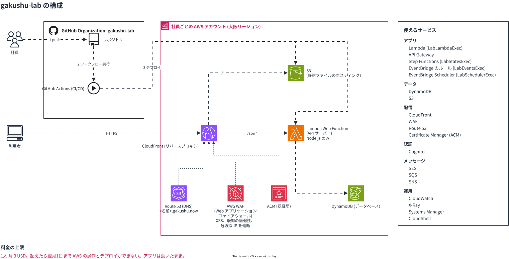

# gakushu-lab

図の元ファイルは [architecture.drawio](https://github.com/gakushu-lab/.github/blob/main/profile/diagrams/architecture.drawio)。

詳細な gakushu-lab の構成は[こちら](https://github.com/gakushu-lab/.github/blob/main/profile/gakushu-lab.md)。

## アプリのデプロイ手順

1. ドメイン (example.com のような URL のホスト名部分) を取得してDNSに登録する (Route 53)
2. データベースを作る (DynamoDB)
3. API サーバーをデプロイしてデータベースに接続させる (Lambda Web Function)
4. フロントエンドの静的ファイルをホスティングする (S3)
5. リバースプロキシで `/api/*` だけを API サーバーに転送する (CloudFront)
6. DNS の A レコードにリバースプロキシの IP アドレスを登録する (Route 53)
7. 認証局に TLS 証明書を発行してもらいリバースプロキシに設定する (ACM, CloudFront)

### AWS 上でのやり方

[こちら](https://github.com/gakushu-lab/.github/blob/main/profile/deploy-aws.md)を参照

## 制約

- リージョンは大阪 (ap-northeast-3)。CloudFront の証明書と AWS WAF だけ us-east-1
- IAM ロールは作れない。用意済みの次のロールを使う
  - Lambda: `LabLambdaExec`
  - EventBridge Scheduler: `LabSchedulerExec`
  - Step Functions: `LabStatesExec`
  - EventBridge のルール: `LabEventsExec`
  - GitHub Actions: `LabGitHubDeploy`
- API サーバーは環境変数 `AWS_LAMBDA_HTTP_ENDPOINT` (host:port) で待ち受ける
- アクセスキーは使わない
- `LabGitHubDeploy` は gakushu-lab のリポジトリで本人が起こした実行だけを受け付ける
- 1人 月 3 USD まで。超えると翌月1日まで AWS の操作が止まる。動いているアプリは止まらない
- CloudFront の Free プランは1アカウント3つまで。AWS WAF の web ACL が必須

例: [hapax](https://github.com/gakushu-lab/hapax)
