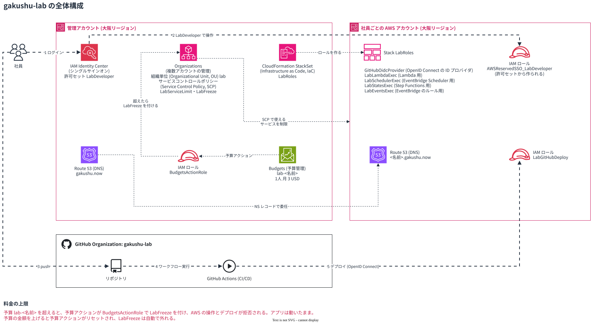

# gakushu-lab の全体構成

図の元ファイルは [gakushu-lab.drawio](diagrams/gakushu-lab.drawio)。

## ポリシーとテンプレート

| ファイル | 内容 | 適用先 |
| --- | --- | --- |
| [lab-service-limit.json](policies/lab-service-limit.json) | サービスコントロールポリシー (Service Control Policy, SCP) `LabServiceLimit`。使えるサービスを限り、常に料金がかかる操作を拒否する | 組織単位 (Organizational Unit, OU) `lab` |
| [lab-freeze.json](policies/lab-freeze.json) | SCP `LabFreeze`。社員と GitHub Actions の AWS の操作をすべて拒否する | 予算を超えた社員のアカウント。予算アクションが付け外しする |
| [lab-developer-inline.json](policies/lab-developer-inline.json) | 許可セット `LabDeveloper` のインラインポリシー。IAM の参照と、実行ロール4つの PassRole を許可する。AWS 管理ポリシー `PowerUserAccess` と一緒に付ける | IAM Identity Center の許可セット `LabDeveloper` |
| [lab-roles.yaml](policies/lab-roles.yaml) | StackSet `LabRoles` のテンプレート。OpenID Connect の ID プロバイダと IAM ロール5つを作る | OU `lab` の全アカウント (大阪リージョン) |
| [budgets-action-role-trust.json](policies/budgets-action-role-trust.json) | `BudgetsActionRole` の信頼ポリシー。管理アカウントの Budgets だけが使える | 管理アカウントの `BudgetsActionRole` |
| [budgets-action-role-permissions.json](policies/budgets-action-role-permissions.json) | `BudgetsActionRole` のインラインポリシー `AttachLabFreeze`。SCP の付け外しを許可する | 管理アカウントの `BudgetsActionRole` |
